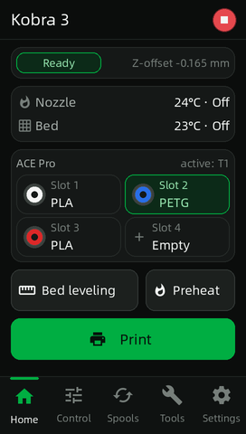
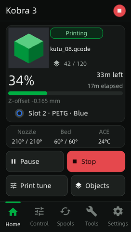
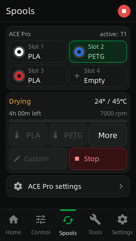
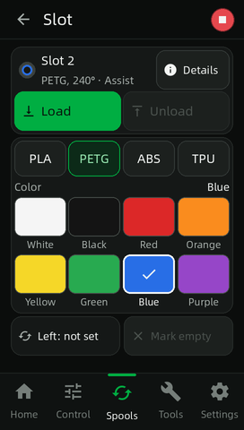
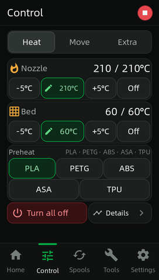
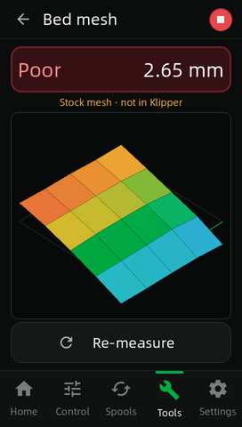
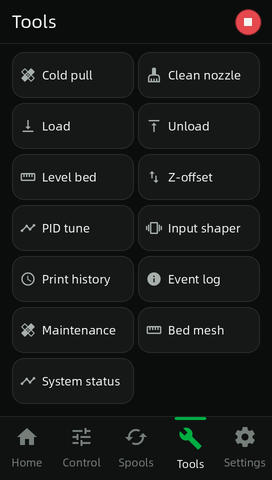
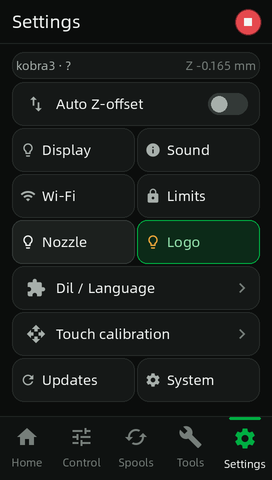

# LibreCubic3

**A Rinkhals add-on package for the Anycubic Kobra 3 + ACE Pro.** It installs from a USB stick: no SSH, no tools on your computer, no cables.

On the printer and in this repository's folders the package keeps its internal name `open-kobra` (folders, app names, log files), so existing installs upgrade cleanly.

> ⚠️ **Experimental software.** Tested on a single Kobra 3 only. It makes persistent changes to your printer (an uninstall package is provided). No warranty of any kind; use at your own risk.

## What it does

| Component | Purpose |
|---|---|
| **kobra-screen** | A new touchscreen UI for mainline Klipper + Moonraker (English / Turkish): printing (with bed mesh and Z probe on/off per print, and automatic ACE slot matching: each colour in the file goes to the loaded slot with the same material and the closest colour), temperatures, axes, files, ACE Pro slots and drying, Wi-Fi, wizards (Z-offset measurement, nozzle cleaning, cold pull, PID, input shaper), system status (CPU, memory, MCU load). Installed **disabled**. |
| **ACE Pro driver** | Klipper driver for the ACE Pro: load/unload, drying, RFID, tangle protection, per-print tool-to-slot map (`ACE_SET_TOOL_MAP`), RFID recognition off while printing (like the stock software, so drying during a print keeps working). Based on [Kobra-S1/ACEPRO](https://github.com/Kobra-S1/ACEPRO) with fixes for USB disconnects, drying and error handling. With no ACE plugged in, the printer prints from an external spool like stock (tool changes are skipped, the normal runout sensor is used). |
| **Print start and motion** | Stock Kobra 3 Y travel limit (260 mm) and X driver interpolation, a nozzle wipe that first probes the bed next to the wiper, purging only over the purge chute, retraction before the nozzle moves over the bed, and a shorter purge line. |
| **LeviQ3** | A mainline Klipper re-implementation of the stock firmware's automatic Z-offset (nozzle contact) and bed leveling commands. |
| **numpy** | numpy built for the printer's CPU and C library, so Klipper's resonance measurement (`SHAPER_CALIBRATE`) works on the printer itself. |
| **Boot guard** | If a Rinkhals or Klipper update deletes the LeviQ3 files, restores them at boot; if it cannot, it makes sure Klipper still starts. |
| **ace-standalone** | A small web panel for running only the ACE Pro (drying, filament) while the Klipper ACE driver is not using it. Installed disabled. |

The package never writes to Anycubic's stock files; it only adds files to the Rinkhals user area and to the vanilla-klipper app.

## Screenshots

<table>
  <tr>
    <td></td>
    <td></td>
    <td></td>
    <td></td>
  </tr>
  <tr>
    <td align="center">Home</td>
    <td align="center">Printing</td>
    <td align="center">Spools and ACE dryer</td>
    <td align="center">ACE slot</td>
  </tr>
  <tr>
    <td></td>
    <td></td>
    <td></td>
    <td></td>
  </tr>
  <tr>
    <td align="center">Temperatures</td>
    <td align="center">Bed mesh</td>
    <td align="center">Tools and wizards</td>
    <td align="center">Settings</td>
  </tr>
</table>

**All 51 screens, one per page:** [docs/screenshots](docs/screenshots/README.md) · **everything on one sheet:** [sheet.png](docs/screenshots/sheet.png)

## Requirements

**Required:**

- **Anycubic Kobra 3** (or Kobra 3 Combo). The installer checks the model and stops without touching anything on other printers.
- **Rinkhals** ([rinkhals-community/Rinkhals](https://github.com/rinkhals-community/Rinkhals)), the **vanilla-klipper app with ACE Pro support** ([Kobra-S1/vanilla-klipper-swu](https://github.com/Kobra-S1/vanilla-klipper-swu)) and Rinkhals' **Moonraker** app. The **all-in-one package** installs all of them; the regular package needs them installed first.
- For the all-in-one package: stock firmware **2.4.6.7**. It refuses other versions without changing anything.
- A USB stick formatted **FAT32** with an **MBR** partition table (GPT does not work).
- At least 10 MB free on the printer.

**Tested with:** Kobra 3 firmware 2.4.6.7, Rinkhals 20261101_01, vanilla-klipper 0.3, ACE Pro (Gen 1) firmware V1.3.863.

**Optional:**

- **ACE Pro.** Everything else works without it; with no ACE connected the printer uses an external spool automatically. ACE Pro 2 has not been tested.

**Not needed:** SSH, ADB, Docker, software on your computer, internet access during installation.

## Installation (USB)

There are two packages on the [Releases](../../releases) page:

- **`LibreCubic3-<version>-all-in-one.zip`**: for a Kobra 3 on stock firmware 2.4.6.7. One USB stick installs Rinkhals, vanilla-klipper and LibreCubic3.
- **`LibreCubic3-<version>-install.zip`**: if Rinkhals and vanilla-klipper are already installed, or to update LibreCubic3.

### All-in-one (stock printer)

1. Download **`LibreCubic3-<version>-all-in-one.zip`** and unzip it to the **root** of the USB stick. It must contain `aGVscF9zb3Nf/update.swu`.
2. Insert the USB stick while the printer is on. **Do not turn the printer off** until it restarts by itself (about 5 minutes).
   - First beep: started. The Rinkhals progress bar appears on the screen, then the printer restarts once.
   - **3 short beeps without a restart:** nothing was changed (not a Kobra 3, firmware is not 2.4.6.7, damaged download or not enough space). The reason is in `aGVscF9zb3Nf/open-kobra-bundle-install.log` on the stick.
3. After the restart the LibreCubic3 touchscreen UI starts. If an ACE Pro was connected during installation it is already enabled; otherwise see step 5 of the vanilla-klipper part below.

What it installs: Rinkhals 20261101_01, vanilla-klipper 2026-06-01 (0.3) and this LibreCubic3 version, with kobra-screen and vanilla-klipper enabled. If the same Rinkhals is already installed it is skipped. Log: `/useremain/open-kobra-bundle-install.log` and on the stick.

### Step by step (Rinkhals already installed)

The printer reads one `update.swu` per USB insertion, so this takes two rounds.

#### 1. Install vanilla-klipper (skip if already installed)

1. Download **`app-vanilla-klipper-k2p-k3.swu`** from the newest folder under [Kobra-S1/vanilla-klipper-swu → releases](https://github.com/Kobra-S1/vanilla-klipper-swu/tree/main/releases).
2. On the USB stick, create a folder named `aGVscF9zb3Nf` and copy the file into it renamed to **`update.swu`** (`aGVscF9zb3Nf/update.swu`).
3. Insert the USB stick into the printer. First beep: started. Second beep: done.
4. On the printer screen open **Settings → Rinkhals → Manage apps**, tick **vanilla-klipper**, then **Enable App → Start App**. The first start takes about a minute.
5. If you have an ACE Pro: in Mainsail, open `printer.klipper.cfg`, remove the `#` in front of `[include ace_K3.cfg]`, save and restart Klipper.

Details: [vanilla-klipper installation guide](https://github.com/Kobra-S1/vanilla-klipper-swu/blob/main/vanilla-klipper.md).

#### 2. Install LibreCubic3

1. Download **`LibreCubic3-<version>-install.zip`** from [Releases](../../releases).
2. Delete the old `aGVscF9zb3Nf` folder from the USB stick, then unzip the file to the **root** of the stick. It must contain `aGVscF9zb3Nf/update.swu`.
3. Insert the USB stick while the printer is on.
   - **1 beep:** installation started.
   - **2nd beep:** installation finished.
   - **3 short beeps:** something went wrong. Changes from that run are rolled back automatically. Details are in `aGVscF9zb3Nf/open-kobra-install.log` on the stick.
4. Remove the USB stick and **restart the printer.**
5. To use the new touchscreen UI: on the printer screen open **Settings → Rinkhals → Manage apps**, tick `kobra-screen` and restart.

To update, repeat step 2 with the new version's zip. Your settings are kept.

> After updating Rinkhals or the vanilla-klipper app, install LibreCubic3 once more: those updates reset Klipper's extension folder. The boot guard restores LeviQ3, but the ACE driver and numpy need a reinstall.

## Uninstalling

1. Delete the old `aGVscF9zb3Nf` folder from the USB stick.
2. Unzip **`LibreCubic3-<version>-uninstall.zip`** to the root of the stick, insert it and wait for the second beep.

Uninstalling does not delete your `printer.klipper.cfg`; saved settings such as Z-offset, bed mesh and PID stay. It removes LibreCubic3 only: Rinkhals and vanilla-klipper (also when installed by the all-in-one package) stay; see their own projects to remove them.

## If something goes wrong

- **The printer does not boot or hangs:** put an empty file named `.disable-rinkhals` in the root of a USB stick and restart the printer. The stock Anycubic software starts. Once fixed, an empty `.enable-rinkhals` file turns Rinkhals back on.
- **The touchscreen UI does not start:** if `kobra-screen` crashes repeatedly it disables itself and brings back the stock screen. You can also go back from the screen with **Settings → Return to stock**.
- More installation and recovery notes: [open-kobra/README.md](open-kobra/README.md)

## Building from source

On a Linux computer you only need `sh`, `tar`, `gzip`, `zip`, `md5sum` and `python3`:

```sh
cd open-kobra
./build.sh
```

The result is `open-kobra/dist/install/aGVscF9zb3Nf/update.swu`; copy that folder to the root of the USB stick.

The all-in-one package: put Rinkhals' `update-k2p-k3.swu` (20261101_01) and vanilla-klipper's `app-vanilla-klipper-k2p-k3.swu` (2026-06-01) into `open-kobra/vendor/bundle/` (download links and SHA-256 at the top of `build_bundle.sh`), then run `./build_bundle.sh`. `./test_bundle.sh` runs the real Rinkhals, vanilla-klipper and LibreCubic3 installers on a simulated stock printer (needs `bwrap`).

Tests:

```sh
cd open-kobra && ./test.sh
cd kobra-screen && python3 -m unittest discover -p 'test_*.py'   # needs Pillow
cd ace-driver && python3 -m unittest discover -s tests
cd leviq3-klipper && python3 -m unittest test_leviq3
```

The UI text-fit tests need the printer's font (`AlibabaSans-Regular.ttf`). It is not in this repository because its license is unclear; copy it from Rinkhals into `kobra-screen/fonts/` to run those tests, otherwise they are skipped.

## Folders

| Folder | Contents |
|---|---|
| `open-kobra/` | USB installation package: build script, install/uninstall scripts, boot guard, tests |
| `kobra-screen/` | Touchscreen UI |
| `ace-driver/` | Klipper ACE Pro driver |
| `leviq3-klipper/` | LeviQ3 Klipper extension |
| `ace-standalone/` | Standalone ACE Pro web panel |
| `tools/ace-fw/` | Advanced: ACE Pro dryer cool-down patch and a reset-cause diagnostic image (details inside; needs SSH) |
| `tools/numpy-uclibc/` | How the bundled numpy was built |

## Feedback, bugs, security

- **Bugs and feature requests:** open an issue on the [Issues](../../issues) page. Questions and ideas are welcome in [Discussions](../../discussions).
- **Security vulnerabilities:** do not open a public issue; follow [SECURITY.md](SECURITY.md).
- Contributing: [CONTRIBUTING.md](CONTRIBUTING.md)

Before attaching logs, remove your Wi-Fi name, IP addresses and serial numbers.

## License

GPLv3, see [LICENSE](LICENSE). Third-party components and credits: [NOTICE.md](NOTICE.md).

This project is not affiliated with Anycubic. "Anycubic", "Kobra" and "ACE Pro" are trademarks of their owners.
