# Screenshots

kobra-screen in English, rendered on a computer against the fake Moonraker server (`kobra-screen/make_preview.py --pages`). The printer's screen is 272×480.

All screens on one sheet: [sheet.png](sheet.png)

### 1. Home (idle)

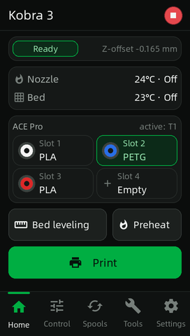

### 2. Files

### 3. File details

### 4. Home (printing)

### 5. Print tune

### 6. Print objects (exclude object)

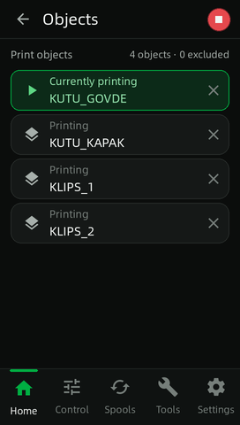

### 7. Control: temperatures

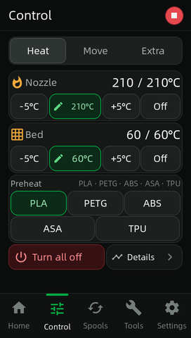

### 8. Temperature chart

### 9. Keypad

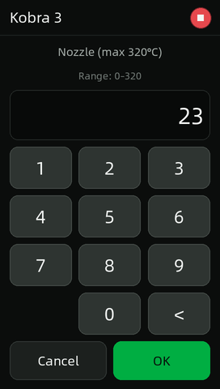

### 10. Heating confirmation

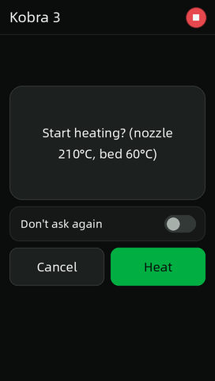

### 11. Control: move

### 12. Control: fans, lights, extruder

### 13. Spools and ACE dryer

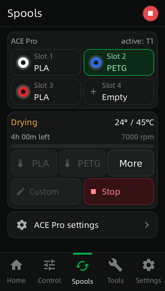

### 14. ACE slot

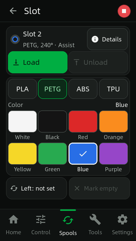

### 15. Remaining filament

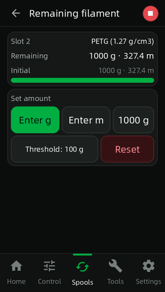

### 16. Slot details

### 17. ACE Pro: status

### 18. ACE Pro: features

### 19. ACE Pro: actions

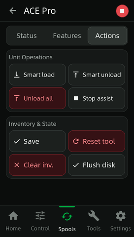

### 20. Tools

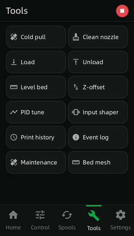

### 21. Print history

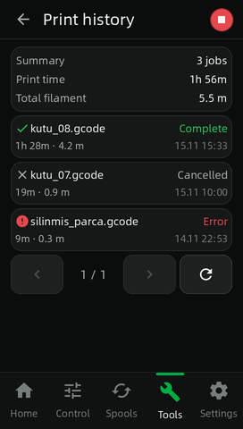

### 22. Print details

### 23. Event log

### 24. Maintenance reminders

### 25. Bed mesh

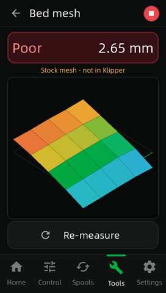

### 26. Bed mesh (rotated by finger drag)

### 27. Bed mesh re-measure confirmation

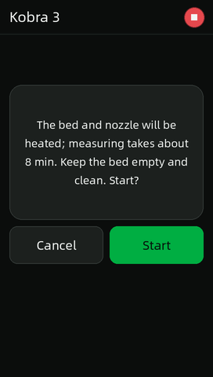

### 28. Cold pull wizard: heating

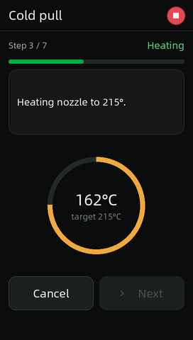

### 29. Cold pull wizard: cooling

### 30. Settings

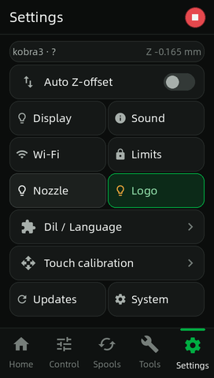

### 31. Display

### 32. Sound alerts

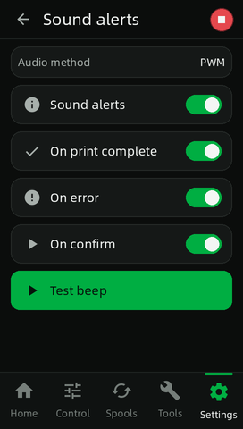

### 33. Updates

### 34. System

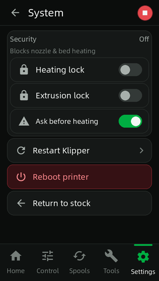

### 35. Language

### 36. Touch calibration

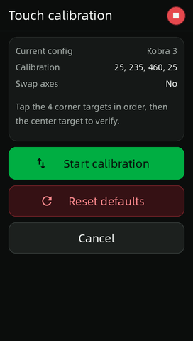

### 37. Touch calibration: corner targets

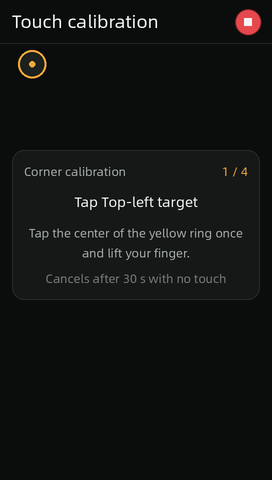

### 38. Touch calibration: verification

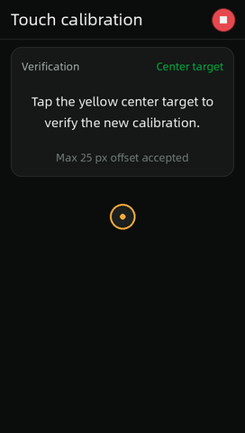

### 39. Touch calibration: confirm

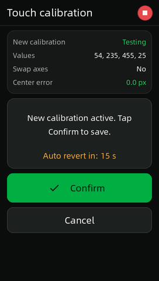

### 40. Wi-Fi networks

### 41. Keyboard

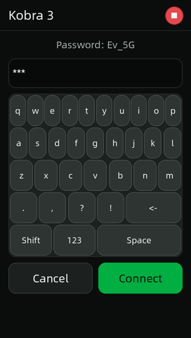

### 42. Wi-Fi network details

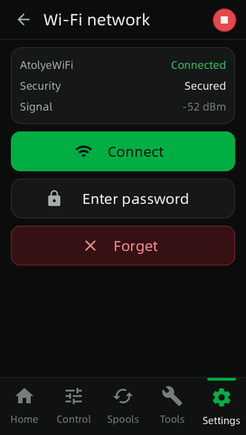

### 43. Limits: temperatures

### 44. Limits: motion and LeviQ3

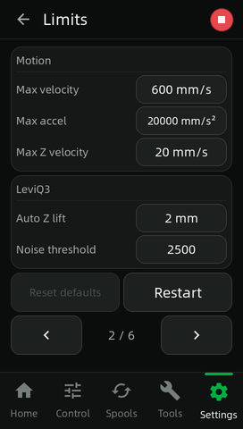

### 45. Limits: nozzle heater check

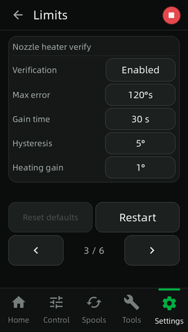

### 46. Limits: bed heater check

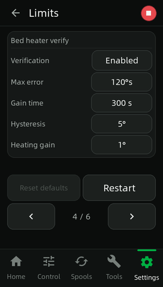

### 47. Limits: ACE heating and feed

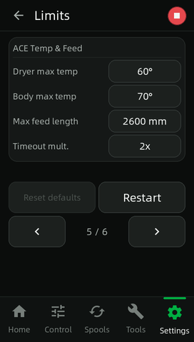

### 48. Limits: ACE sensors

### 49. Emergency stop confirmation

