# Screenshots

kobra-screen in English, rendered on a computer against the fake Moonraker server (`kobra-screen/make_preview.py --pages`). The printer's screen is 272×480.

All screens on one sheet: [sheet.png](sheet.png)

### 1. Home (idle)

### 2. Files

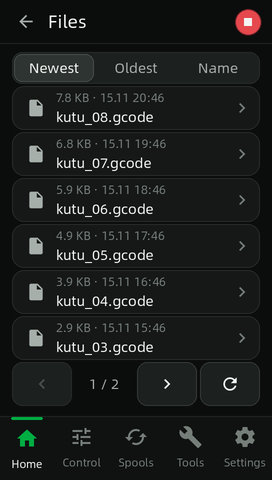

### 3. File details

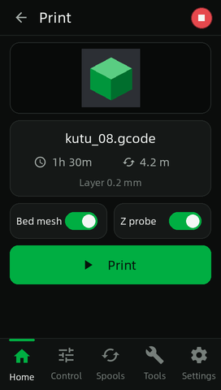

### 4. Home (printing)

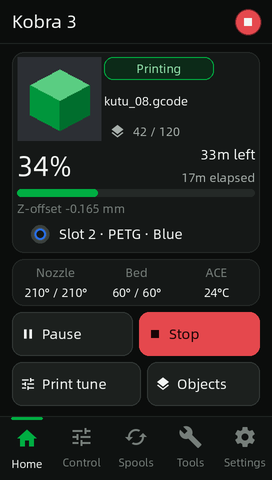

### 5. Print tune

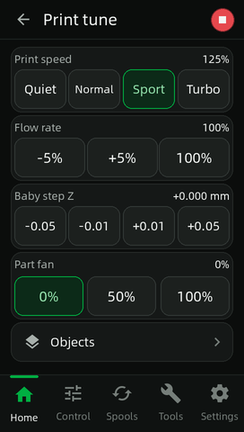

### 6. Print objects (exclude object)

### 7. Control: temperatures

### 8. Temperature chart

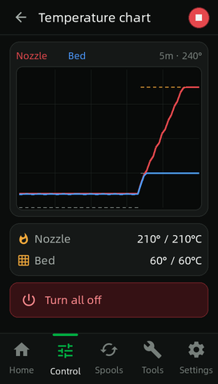

### 9. Keypad

### 10. Heating confirmation

### 11. Control: move

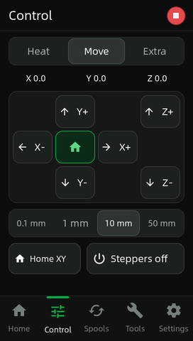

### 12. Control: fans, lights, extruder

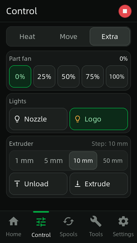

### 13. Spools and ACE dryer

### 14. ACE slot

### 15. Remaining filament

### 16. Slot details

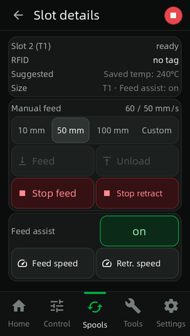

### 17. ACE Pro: status

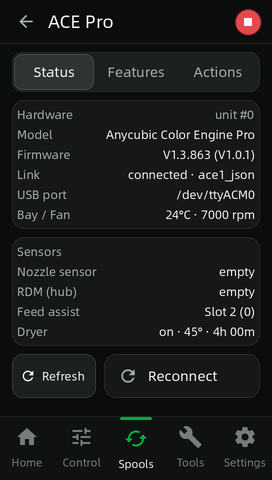

### 18. ACE Pro: features

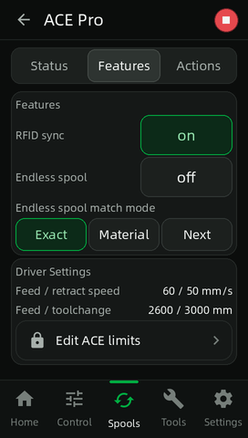

### 19. ACE Pro: actions

### 20. Tools

### 21. Print history

### 22. Print details

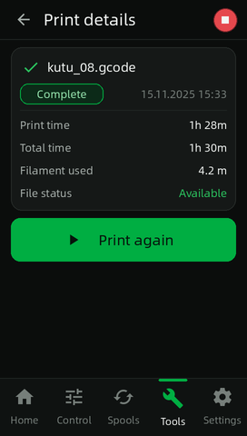

### 23. Event log

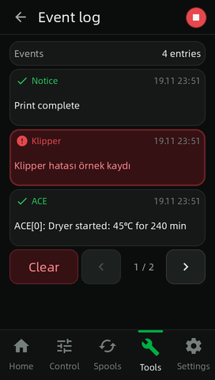

### 24. Maintenance reminders

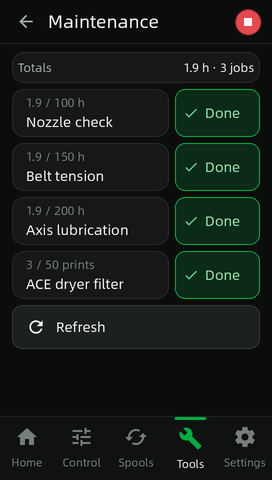

### 25. Bed mesh

### 26. Bed mesh (rotated by finger drag)

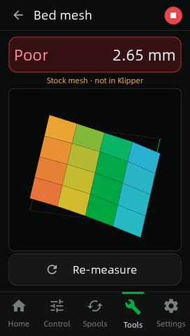

### 27. Bed mesh re-measure confirmation

### 28. Tools: system status

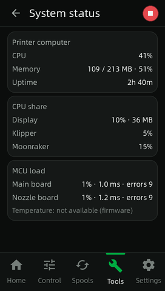

### 29. Cold pull wizard: heating

### 30. Cold pull wizard: cooling

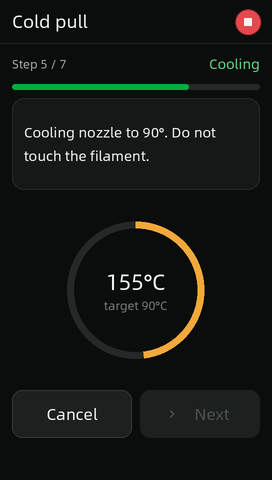

### 31. Settings

### 32. Display

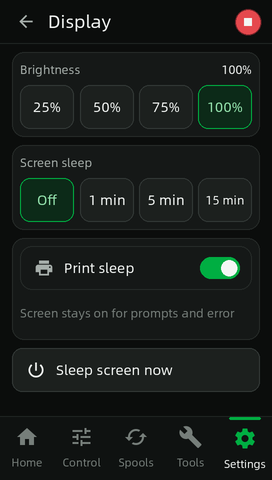

### 33. Sound alerts

### 34. Updates

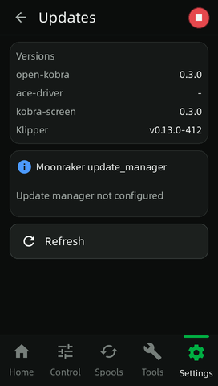

### 35. System

### 36. Language

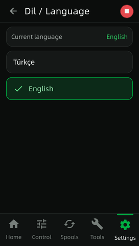

### 37. Touch calibration

### 38. Touch calibration: corner targets

### 39. Touch calibration: verification

### 40. Touch calibration: confirm

### 41. Wi-Fi networks

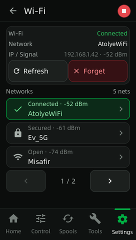

### 42. Keyboard

### 43. Wi-Fi network details

### 44. Limits: temperatures

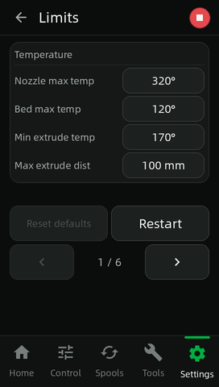

### 45. Limits: motion and LeviQ3

### 46. Limits: nozzle heater check

### 47. Limits: bed heater check

### 48. Limits: ACE heating and feed

### 49. Limits: ACE sensors

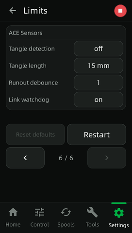

### 50. Emergency stop confirmation

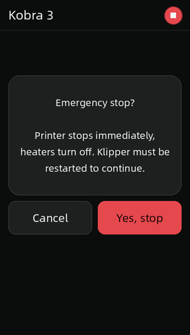
